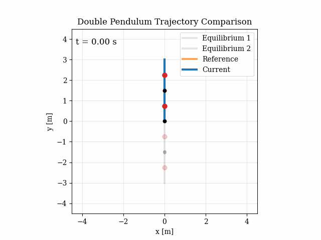

# Optimal Control of a Flexible Robotic Link

Trajectory generation and tracking for an under-actuated **flexible double pendulum** (a planar 2-DoF arm with nonlinear joint stiffness), using Newton's method for optimal control together with LTV-LQR and constrained LTV-MPC.

Course project for *Optimal Control and Reinforcement Learning* (OPTCON-RL), MSc Automation Engineering, University of Bologna, A.Y. 2025/2026.

<p align="center">
  
</p>

## Overview

- **Modelling:** equations of motion of the flexible double pendulum (mass matrix, Coriolis, gravity, nonlinear stiffness), Forward Euler or RK4 discretisation, analytic Jacobians, equilibrium manifold analysis, and PBH stabilisability tests.
- **Reference generation:** cubic, quintic or stepwise interpolation between equilibrium configurations.
- **Optimal trajectory generation:** Newton's method for optimal control. Each iteration solves an affine LTV-LQR subproblem (backward Riccati pass), then a forward pass with Armijo line search.
- **Dynamic horizon extension:** for hard maneuvers, if the solver converges but the terminal error is still above tolerance, the horizon is extended automatically and optimisation continues.
- **Trajectory tracking:** time-varying LQR around the optimal trajectory, compared with a linear time-varying MPC (CasADi + IPOPT) that handles input constraints explicitly, both tested under perturbed initial conditions.

Tasks include `swing_up`, `elbow_up`, `swing_down`, `complex_maneuver`, `topside_pump`, `diagonal_swing`, `top_to_elbow_up`, `low_diagonal_hold` and `half_swing_up`.

The full write-up is in [`report/report_group_10.pdf`](report/report_group_10.pdf).

## Running

```bash
pip install -r requirements.txt
python code/main.py        # run from the repo root
```

Settings live at the top of `code/main.py`:

```python
GENERATOR = "Newton"            # Newton | Newton-Extended
TRACKER = "LQR"                 # LQR | MPC
GENERATION_ONLY = False         # stop after trajectory generation
TASKS = ['swing_up', 'elbow_up', 'swing_down', 'complex_maneuver']
```

Further hyperparameters in the same file control discretisation (`fe`/`rk4`, `dt`), the reference method, cost weights, horizon extension, perturbation scale and the MPC prediction horizon.

Plots and animations are saved to `report/figs/code/<generator|tracker>/<task>/`.

## Structure

| Path | Contents |
|---|---|
| `code/main.py` | Entry point: sets up the model, generates and optimises trajectories, runs tracking, saves results |
| `code/model.py` | Flexible double pendulum dynamics, Jacobians, kinematics, equilibria, PBH test |
| `code/trajectory_reference_generation.py` | Reference trajectories between equilibria |
| `code/trajectory_generation_newton*.py` | Newton's method, standard and with horizon extension |
| `code/armijo.py` | Armijo line search |
| `code/trajectory_tracking_LQR.py` / `_MPC.py` | LTV-LQR and LTV-MPC trackers |
| `code/solver.py`, `code/costs.py` | Integrators, Riccati recursions, MPC setup, cost functions and derivatives |
| `code/plots.py`, `code/animation.py` | Plots and animations |
| `report/` | LaTeX report, figures and compiled PDF |
| `code_project_old_versions/` | Earlier development branches |

## Authors

- Francesco Cenni ([@Frasco-eng](https://github.com/Frasco-eng))
- Giulio Mazzaroppi ([@Giulio-Mazzar](https://github.com/Giulio-Mazzar))
- Giacomo Pezzolati ([@giacomo2k2](https://github.com/giacomo2k2))

## License

[MIT](LICENSE)
